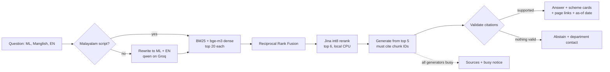

# Sahayi

**Which Kerala government schemes can you get? Ask in Malayalam, Manglish or English.**
Sahayi answers from official scheme documents only. Every claim links to the source page, and
if the documents don't support an answer, it says so instead of guessing. It needs no GPU and
stores no user profiles. It runs on a laptop, with the language model reached through an API.

**Status:** complete as a local app with an optional temporary demo link. The final Gate 2 run is
still in progress on Groq's free tier, so the Gate 2 table below may be marked interim.

## How it works



| Layer | Choice |
|---|---|
| Extraction | PyMuPDF; Tesseract (`mal+eng`) for scanned pages |
| Retrieval | BM25 + `BAAI/bge-m3` over contextual chunk headers (Qdrant, local), fused with RRF |
| Reranker | `jina-reranker-v2-base-multilingual` int8 ONNX, local, top 6 at 256 tokens |
| Query rewrite | `qwen/qwen3.8-27b` on Groq; skipped for Malayalam-script questions |
| Generator chain | `qwen/qwen3.8-27b` → `openai/gpt-oss-20b` → `gemini-3.6-flash`, then busy mode |
| App | FastAPI (Python 3.11), React + Vite + Tailwind |
| Evals | RAGAS-style metrics (re-implemented, see Limitations), hit@k, MRR, citation accuracy, abstention |

## How to run locally

You need Python 3.11, Node 22, the built data under `data/` (see [Setup](#setup) and
[Ingestion](#ingestion)) and `GROQ_API_KEY` in `.env`.

```bash
python tasks.py up      # builds the UI, starts http://127.0.0.1:8077, checks /health, opens the browser
python tasks.py down    # stops it
```

Start-up takes about 25–30 s while the models load. It works while an eval is running, because the
app reads its own copy of the index. They share one Groq quota, though, so answers may then be
slow or show the busy notice. `python tasks.py up --retrieval-only` makes no LLM calls.

## Demo link

```bash
python tasks.py share   # prints a https://….trycloudflare.com link. Ctrl+C closes it.
```

The first run downloads `cloudflared` to `tools/` and checks it against the published checksum.

While sharing:

- **Limits:** 5 requests a minute per visitor, and 100 generated answers a day across everyone
  (`DEMO_RATE_LIMIT_PER_MIN`, `DEMO_DAILY_CAP`). Past the daily cap, visitors get sources and a
  busy notice with no LLM calls. Cached answers don't count toward the cap.
- **Answer cache:** on. General questions are reused for 7 days; anything personal is never stored.
- **Privacy:** logs keep only a keyed hash of each question. A check through a real tunnel found
  no question text in the logs or the answer cache. The API docs page is switched off.

**Risks:**

- **Your laptop is the server.** If it sleeps, shuts down or loses its connection, the link stops.
- **The URL changes every time,** so old links stop working. Quick tunnels have no uptime guarantee.
- **Anyone with the link can use it,** and their questions spend your Groq quota, up to the cap.
- **Questions leave your machine.** They pass through Cloudflare and go to Groq, and may go to
  Google if `GEMINI_API_KEY` is set. Google's free tier may use them to improve its products, so
  ask visitors not to type personal details, or use a paid key.
- **Keep it short.** Share only for the demo, then press Ctrl+C. If `share` was killed some other
  way, `python tasks.py down` also closes the tunnel.
- **Busier means slower.** Questions are answered one at a time on your CPU.

## Rebuild the data

`data/` is not in git: it holds the downloaded documents, indexes and model caches. To rebuild it:

```bash
python tasks.py setup    # dependencies, Playwright Chromium, the pre-commit hook
python tasks.py ingest   # download, extract, clean, chunk
python tasks.py index --context    # BM25 + Qdrant, with the headers the default config uses
python tasks.py gold     # resolve the gold questions against the new chunks
python tasks.py eval     # retrieval eval: should reach Gate 1 (hit@5 >= 0.85)
```

| key (in `.env`) | needed for |
|---|---|
| none | `ingest`, `index` and `gold` |
| `GROQ_API_KEY` | `eval` (query rewrite), the app and answer evals |
| `GEMINI_API_KEY` | optional: last generator in the chain, and the second judge |
| `JINA_API_KEY` | optional: only for hosted rerank |

You also need Tesseract with Malayalam for scanned pages ([details](#tesseract--malayalam-needed-for-ocr)).
Some government hosts can't always be reached, and those documents have to be added by hand
([details](#unreachable-sources-and-manual-drops)). Documents change over time, so a rebuild may
not match the published numbers exactly.

## Results

### Gate 1: retrieval

171 gold questions: 146 answerable and 25 no-answer. From `evals/results/2026-10-30_2032_retrieval.md`.

| metric | target | result |
|---|---|---|
| hit@5 | ≥ 0.85 | **0.897** (EN 0.906, ML 0.891, Manglish 0.889, held-out 0.80) |
| MRR@10 | ≥ 0.70 | **0.793** |

### Gate 2: answers

<!-- gate2:start -->
**INTERIM, does not count.** Progress: qwen/qwen3.8-27b 53/186, openai/gpt-oss-20b 81/186

**Production primary: none** (not picked: the runs have not finished).

#### Side by side

| metric | qwen/qwen3.8-27b | openai/gpt-oss-20b |
|---|---|---|
| items run | 53 | 81 |
| answerable gold n (needs ≥ 120) | 53 | 81 |
| faithfulness (≥ 0.90) | 0.965 | 0.883 |
| citation accuracy (≥ 0.90) | 0.97 | 0.854 |
| Gate 2 | does not count yet | does not count yet |
| eligibility accuracy (≥ 0.80) | None (n=0) | None (n=0) |
| abstention recall (≥ 0.90) | – | – |
| abstention precision | 0.0 | 0.0 |
| false abstain rate | 0.151 | 0.247 |
| ₹ / query, mean | 0.532 | 0.03 |
| provider failures excluded | 0 | 0 |

#### Truncation

| generator | compact retries | failed after retry | failure rate |
|---|---|---|---|
| qwen/qwen3.8-27b | 4 | 1 | 0.019 |
| openai/gpt-oss-20b | 0 | 0 | 0.0 |

#### By slice and language

| slice | qwen3.8-27b n | qwen3.8-27b faith. | qwen3.8-27b cite | gpt-oss-20b n | gpt-oss-20b faith. | gpt-oss-20b cite |
|---|---|---|---|---|---|---|
| main | 33 | 0.966 | 0.978 | 61 | 0.876 | 0.848 |
| heldout | 20 | 0.964 | 0.957 | 20 | 0.907 | 0.875 |
| eligibility | 0 | – | – | 0 | – | – |
| no_answer | 0 | – | – | 0 | – | – |
| en | 15 | 0.96 | 0.971 | 25 | 0.948 | 0.775 |
| ml | 16 | 0.945 | 0.943 | 25 | 0.875 | 0.882 |
| manglish | 22 | 0.983 | 0.99 | 31 | 0.838 | 0.885 |

#### Live latency (ms, p50 / p95)

| generator | n | first source (TTFC) | first answer token (TTFT) | full answer |
|---|---|---|---|---|
| qwen/qwen3.8-27b | pending | – | – | – |
| openai/gpt-oss-20b | pending | – | – | – |

Free-tier throttling is included.

#### Judge agreement

| generator | judges | answers | statements | supported | cited ok |
|---|---|---|---|---|---|
| qwen/qwen3.8-27b | pending | – | – | – | – |
| openai/gpt-oss-20b | pending | – | – | – | – |

The main judge, gpt-oss-120b, comes from the same model family as gpt-oss-20b, so its scores for that generator may be less independent. The Gemini check is the guard, on a small sample.

<!-- gate2:end -->

Full table: `evals/results/gate2_final.md`. Metric definitions: `evals/answer_eval.py`.

### Ablations

**Chunking × retrieval × rerank** (no rewrite and no contextual headers, so these sit below the
default):

<!-- ablation:start -->
| chunking | retrieval | rerank | hit@1 | hit@5 | hit@10 | MRR@10 | EN | ML | Manglish | p95 ms |
|---|---|---|---|---|---|---|---|---|---|---|
| fixed | bm25 | none | 0.278 | **0.524** | 0.603 | 0.378 | 0.623 | 0.391 | 0.556 | 2 |
| fixed | dense | none | 0.54 | **0.778** | 0.865 | 0.641 | 0.755 | 0.935 | 0.556 | 245 |
| fixed | hybrid | none | 0.405 | **0.73** | 0.833 | 0.55 | 0.736 | 0.826 | 0.556 | 198 |
| fixed | hybrid | Jina int8 top-6 | 0.563 | **0.762** | 0.833 | 0.653 | 0.755 | 0.87 | 0.593 | 1047 |
| recursive | bm25 | none | 0.286 | **0.5** | 0.587 | 0.385 | 0.566 | 0.391 | 0.556 | 2 |
| recursive | dense | none | 0.516 | **0.81** | 0.889 | 0.638 | 0.849 | 0.913 | 0.556 | 163 |
| recursive | hybrid | none | 0.437 | **0.73** | 0.833 | 0.566 | 0.755 | 0.783 | 0.593 | 178 |
| recursive | hybrid | Jina int8 top-6 | 0.563 | **0.738** | 0.833 | 0.65 | 0.755 | 0.826 | 0.556 | 988 |
| section_aware | bm25 | none | 0.198 | **0.492** | 0.563 | 0.336 | 0.547 | 0.391 | 0.556 | 3 |
| section_aware | dense | none | 0.595 | **0.778** | 0.849 | 0.672 | 0.811 | 0.913 | 0.481 | 189 |
| section_aware | hybrid | none | 0.429 | **0.746** | 0.825 | 0.562 | 0.755 | 0.804 | 0.63 | 222 |
| section_aware | hybrid | Jina int8 top-6 | 0.571 | **0.762** | 0.825 | 0.66 | 0.774 | 0.848 | 0.593 | 1024 |
<!-- ablation:end -->

Without rewrite or headers, dense alone beats hybrid and chunking moves hit@5 by only a few points,
which is within noise on this gold set. Section-aware stays the default because it is the only
strategy with contextual headers, which is what the rewrite and hybrid gains were measured on;
headers and rewrite were not tested on the other two.

**Query rewrite** (`evals/results/2026-10-30_2032_retrieval.md`, full default pipeline):

| rewrite | hit@5 | EN | ML | Manglish |
|---|---|---|---|---|
| **skipped for Malayalam script only (default)** | **0.897** | 0.906 | 0.891 | 0.889 |
| always | 0.881 | 0.906 | 0.848 | 0.889 |
| skipped for Malayalam and English | 0.857 | 0.811 | 0.891 | 0.889 |

**Reranker on CPU** (`evals/results/phase2b_summary.md`, older gold-set run):

| reranker | hit@5 | seconds per pair | decision |
|---|---|---|---|
| Jina int8 ONNX, top 6 at 256 tokens | 0.881 | 0.14–0.15 | **default**: the only one fast enough |
| Jina int8 ONNX, top 10 at 384 tokens | 0.929 | 0.23–0.28 | more accurate, too slow |
| bge-reranker-v2-m3 fp32, top 10 at 384 tokens | 0.913 | 0.96–1.1 | far too slow |

**Reranker hosted or local, on 2 cores** (`evals/results/phase4b_deploy.md`): local won, at hit@5
0.897 and p95 2.1 s, against hosted Jina at 0.889 and 2.9 s, which was also rate-limited on a third
of its queries.

**Not measured:** bge-m3 against multilingual-e5, and Gemini as the main generator.

### Latency, cost and memory

**Latency:** "first source" (TTFC), first answer token (TTFT) and full answer. The final live runs
are in the Gate 2 section above once they finish. The last complete live breakdown is from
2026-10-20 (qwen, 25 items), before a thread fix that took 0.55 s off retrieval p95:

| stage | p50 | p95 |
|---|---|---|
| retrieval, including the overlapped rewrite | 1.85 s | 2.32 s |
| generator's first token | 0.70 s | 0.88 s |
| **first answer token (TTFT)** | **2.70 s** | **3.44 s** |
| full answer | 3.41 s | 4.04 s |

**Cost** (per query, at Groq's listed prices; the free tier itself costs nothing): ₹0.48 for qwen
and ₹0.11 for gpt-oss-20b, both including the rewrite (`phase3_summary.md`). The final run's
figures are in the Gate 2 table; those runs use cached rewrites, so they read lower.

**Peak RAM:** 2.7 GB RSS (commit charge 4.8 GB) for the Gate 2 process across its first two
turns (`data/logs/eval_rss.jsonl`), or 1.9 GB with both models as int8 ONNX and no torch.

## Limitations

- **Free-tier rate limits.** Groq allows 8K tokens a minute and 200K a day per model, and qwen
  about 1,000 output tokens a minute. That means one or two qwen answers a minute and about 50 a
  day before falling back. Past the chain, the app shows sources and a busy notice.
- **Judge family.** The main judge, `gpt-oss-120b`, is from the same model family as the
  `gpt-oss-20b` generator, so its scores for that generator may be less independent. Gemini
  re-judges only 15 answers per run, because its free tier allows about 20 requests a day. The
  judge also counts restated user facts as unsupported, so faithfulness is conservative. These
  are RAGAS-style metrics, re-implemented with one judge call per answer, not RAGAS itself.
- **OCR on scanned G.O.s.** Scanned government orders go through Tesseract, and some Malayalam
  PDFs have broken text layers. A misread number or name can reach retrieval, and citations let
  you check against the page, but nothing corrects the text automatically.
- **Corpus freshness.** The corpus is a snapshot. Each answer shows its "as of" date, but nothing
  re-downloads documents, so a changed rule or amount stays wrong until ingestion is run again.
  Some government hosts could not be reached during ingestion
  ([details](#unreachable-sources-and-manual-drops)).
- **Not legal advice.** Eligibility answers are guidance from the documents retrieved. The
  department decides, and a missing document can mean a wrong or missing answer.
- **Gold set size.** 171 questions written for this corpus, with only 20 held out. Treat small
  differences between configs as noise.
- **One user at a time.** Questions are answered one by one on the CPU.

## Future work

- **Cloud deploy.** Docker image and Hugging Face Space notes are in [DEPLOY.md](DEPLOY.md), and an
  Oracle Cloud ARM VM was also considered. None of this has been built or run.
- **WhatsApp bot,** because that's where many users already are.
- **Voice input,** for people who find typing Malayalam hard.

---

Everything below is reference material from the build.

## Setup

Python 3.11:

```bash
python -m venv .venv
.venv/Scripts/activate          # Windows; use `source .venv/bin/activate` on Linux/macOS
python tasks.py setup           # pip install -r backend/requirements.txt + playwright install chromium
```

### Playwright (JS-rendered pages)

myscheme.gov.in, nha.gov.in and the welfare-pension norms (ASP.NET postbacks) render
their content with JavaScript. Sources marked `render: js` are fetched with headless
Chromium via `ingest/render.py`. After installing the requirements, run once:

```bash
playwright install chromium     # or: python -m playwright install chromium
```

### Tesseract + Malayalam (needed for OCR)

Many Kerala government PDFs are scans, or carry a broken Malayalam text layer. Those
pages are OCR'd with Tesseract `mal+eng`. `python -m ingest.extract --no-ocr` runs
without Tesseract, but those pages are then **left out of the chunks** and listed in
the ingest report.

- **Debian/Ubuntu:** `sudo apt install tesseract-ocr tesseract-ocr-mal`
- **Windows:** install the UB Mannheim build (https://github.com/UB-Mannheim/tesseract/wiki).
  Tick *Malayalam* under "Additional language data" during install, or copy
  `mal.traineddata` from https://github.com/tesseract-ocr/tessdata into
  the `tessdata` folder next to `tesseract.exe`.
- **Locating it:** `TESSERACT_CMD` in `.env` (full path to `tesseract.exe`, unquoted) is used if set,
  otherwise `tesseract` on PATH. `ingest.extract` prints the installed languages at
  startup and stops if `mal` or `eng` is missing (`--no-ocr` skips OCR instead).
- Check: `tesseract --list-langs` should list both `eng` and `mal`.

PDF pages are rendered with PyMuPDF, so Poppler is not required.

## Answering + API (Phase 3)

```bash
python tasks.py serve                 # FastAPI on :8077 (models load at startup, ~30 s)
python tasks.py answer-eval -- --all --tag gate2   # resumable; stops cleanly on a daily-quota 429
python evals/summary_3.py evals/results/<run>.json   # Gate 2 tables by slice
```

The pipeline (`backend/app/answer.py`) works like this:

1. **Retrieve.** It uses the Phase 2b `default` retrieval and keeps the top 5 chunks as
   excerpts `[C1]`–`[C5]`.
2. **Generate.** The generator is `qwen/qwen3.8-27b` on Groq, with reasoning off. The
   prompts are in `backend/app/llm/prompts.py`, in English and Malayalam versions. The
   model must:
   - answer only from the excerpts;
   - tag every factual sentence;
   - copy numbers exactly;
   - answer in the user's language (Manglish is answered in Malayalam);
   - return exactly `NO_ANSWER` when nothing in the excerpts is relevant.

   The output is JSON with `answer` first, then scheme cards: `eligible` true / false /
   null, reasons, benefit, how to apply, documents. A null card comes with a
   `follow_up_question`.
3. **Validate** (`backend/app/validate.py`):
   - Tags not in the context are dropped.
   - A sentence with no valid tag is dropped.
   - Every number must appear in a cited chunk or in the user's own question. Digits,
     ₹/Rs, Indian digit grouping and lakh/crore are normalised, and Malayalam numerals
     ൦–൯ are handled.
   - Card fields get the same checks. `eligible` with no surviving reason becomes null.
   - If no answer sentence survives, the answer is rebuilt from validated cards. If
     nothing survives at all, the API abstains and names the department and its
     official site from `ingest/sources.yaml`.
4. **Stream.** Groq's JSON mode does not stream (the whole reply arrives as one delta), so
   generation runs in plain mode with the JSON shape pinned by the prompt. The `answer`
   field is decoded incrementally, and **only sentences that pass validation are
   streamed**.

Endpoints (`backend/app/main.py`):

| endpoint | what |
|---|---|
| `POST /ask` | SSE: `sources` (excerpts), then `token` events (validated sentences), then `result` (the validated JSON with `meta`: latency breakdown, tokens, `cost_inr`, model), or `error` |
| `POST /ask/sync` | the same `result` as one JSON response |
| `GET /schemes` | the 59 schemes, with department, official site and chunk count |
| `GET /source/{chunk_id}` | chunk text and metadata, with a `link` (`#page=N` for PDFs) |
| `GET /health` | loaded models, retrieval config, which API keys are set |

Operational details:

- **Rate limiting:** in-memory, `RATE_LIMIT_PER_MIN` per client IP.
- **CORS:** `localhost:5173`.
- **Request IDs:** an `X-Request-ID` is echoed back, or generated if absent.
- **Logs:** one JSON object per line, also written to `data/logs/queries.jsonl`. A trace
  holds a salted HMAC of the question (never its text), retrieved and cited ids,
  latency, tokens and ₹ cost. Profile facts are not logged.
- **No disk caches in the API:** the rewrite and rerank caches stay off.
- **Cost:** computed from Groq token usage and the prices in `config.py`. Prices were
  checked on 2026-10-20 at console.groq.com/docs/models: gpt-oss-20b $0.075 / $0.30,
  gpt-oss-120b $0.15 / $0.60 and qwen3.8-27b $0.80 / $4.00 per 1M input / output tokens,
  at ₹96.5 per USD.
- **Robustness:**
  - The rewrite has a 2 s deadline (`rewrite_deadline_s`). Without it, a rate-limited
    Groq call held a request for 83 s in a smoke test.
  - The generation fallback retries only once.
- **Hosted rerank:** the `deploy` retrieval config uses hosted Jina rerank with a 1.5 s
  deadline. On any error, a missing `JINA_API_KEY`, or a timeout, it falls back to the
  local Jina int8 model.

### Earlier answer results (2026-10-20, small samples)

Full write-up: `evals/results/phase3_summary.md`. Judge: `openai/gpt-oss-120b`. All runs
are live on Groq's free tier, so the samples are small.

| generator | faithfulness | citation acc. | eligibility acc. | abstain recall (no-answer) | TTFT p50 / p95 | ₹ / query |
|---|---|---|---|---|---|---|
| **qwen3.8-27b** (default) | **0.914** | **0.926** | 3/3 (12 cases quota-blocked) | 6/6 | 2.70 / 3.44 s | 0.48 |
| gpt-oss-20b (prompt v3) | 0.921 | 0.889 | 0.467 (15) | 6/6 | 2.97 / 3.62 s | 0.11 |
| gpt-oss-20b, final pipeline (eligibility set only) | 0.915 | 0.904 | **0.933** (15) | – | not live | – |

- **Gate 2** (≥ 0.90 / ≥ 0.90) passes for qwen.
- **TTFT p95 < 2.5 s is not met yet.** The TTFT above was measured before the
  thread-contention fix. That fix took 0.55 s off retrieval p95, so about 2.9 s is now
  expected.
- **The rest of the gap** is Groq's queue time, the rewrite call and the 8-core CPU
  rerank; the summary has the full breakdown.
- **Hosted Jina rerank:** implemented, but not benchmarked, because `JINA_API_KEY` is not
  set.

## Web UI (Phase 4a)

```bash
cd frontend
npm install
npm run dev        # http://localhost:5173, mock mode: replays recorded answers, no LLM calls
npm run test:e2e   # Playwright smoke test against mock mode; screenshots in frontend/screenshots/
```

Mock mode replays `frontend/mock/streams.json` as real server-sent events; rebuild that file
with `python evals/export_mock_streams.py`. Only the example questions and the abstain question
have recordings. To use the real API, set `VITE_API_URL=http://localhost:8077` in
`frontend/.env` and run `python tasks.py serve`.

## Production behaviour (`backend/app/production.py`)

The API adds these on top of what the evals measure:

- **Generator fallback:** `qwen/qwen3.8-27b` → `openai/gpt-oss-20b` → `gemini-3.6-flash` (if
  `GEMINI_API_KEY` is set), moving on after a 429, a timeout or a 5xx, before any text is sent.
  `meta.model` says which one answered and `meta.fallbacks` which ones failed.
- **Scheme-card filter:** a card must rest on what the answer cites and have an
  eligibility/benefit chunk behind it.
- **Answer cache:** normalised question + language + corpus version, 7-day TTL, in
  `data/cache/api_answers/`. Questions with personal facts are never stored.
- **Busy mode:** if every generator fails, the API returns the sources and cited excerpts as
  cards with a notice, not an error.

Free-tier limit: Groq caps qwen at 1,000 output tokens a minute, about 1–2 answers a minute.

## Deploying (future)

Not part of the current release. See [DEPLOY.md](DEPLOY.md) for Hugging Face Spaces. The 2-core retrieval simulation is in
`evals/results/phase4b_deploy.md`. The Docker image itself has not been built yet.

## Retrieval (Phases 2 and 2b)

```bash
python tasks.py index --context      # BM25 + bge-m3 vectors (contextual headers) in local Qdrant
python tasks.py gold                 # resolve evals/gold/questions_src.yaml -> questions.jsonl
python tasks.py eval                 # default config; Gate 1 = hit@5 >= 0.85
python tasks.py eval dense hybrid_rw_ctx default   # comparison table in evals/results/
python evals/bench_e2e.py --config default         # live latency: real rewrite call, no caches
```

The `default` config (`evals/configs.yaml`) works like this:

1. **Rewrite.** One Groq call (`qwen/qwen3.8-27b`) rewrites the question into Malayalam
   and English (`backend/app/query.py`). The fallback chain is Groq → Gemini (if a key
   is set) → no rewrite.
2. **Retrieve.** BM25 and bge-m3 dense retrieval run for the original question and both
   variants, and the lists are fused with RRF.
3. **Index text.** Chunks are indexed with a contextual header ("scheme — department
   [section]"). The cited text is the raw chunk.
4. **Rerank.** The top 6 are reranked by `jinaai/jina-reranker-v2-base-multilingual`
   (int8 ONNX, 256 tokens). This happens speculatively while the rewrite call is still
   in flight.

Results: **hit@5 0.881** and **live p95 1.95 s** on an 8-core laptop CPU. For full
results, see `evals/results/phase2b_summary.md`.

Other reranker backends sit behind the same config fields (`rerank_backend`):

- `st`: `BAAI/bge-reranker-v2-m3` in fp32. Better quality, but about 1 s per pair on
  CPU.
- `onnx`: our int8 export, built with `python -m backend.app.retrieval.export_onnx`.
- `api`: Cohere or Jina hosted rerankers, enabled by `COHERE_API_KEY` / `JINA_API_KEY`.

Runtime switches (environment):

- `SAHAYI_TORCH_THREADS`: defaults to 8 (physical cores). Use 2 to approximate HF
  Spaces CPU basic.
- `SAHAYI_REWRITE_CACHE=0` / `SAHAYI_RERANK_CACHE=0`: disable the eval caches.
- The rewrite cache stores only `{lang, ml_query, en_query}`, never profile hints. The
  API should keep it off.

All model, ONNX, browser and temp caches live under `data/cache/` on the repo drive:

- `hf/hub`: Hugging Face models.
- `onnx/`: exported ONNX models.
- `playwright/`: Chromium.
- `tmp/`: process temp files.

`backend/app/config.py` sets these paths in-process, so nothing depends on shell
variables.

Gold labels are (doc_id, page) pairs resolved from verbatim evidence snippets, so one
gold set works for every chunking strategy. The gold-set tools are:

- `evals/leakage.py`: lexical-leakage report.
- `evals/verify_gold.py --sample N`: LLM-judge check that each gold page answers its
  question.
- `evals/gold/make_heldout.py`: held-out questions written by a different model
  family.
- `evals/abstain.py`: abstain threshold.

### Latest retrieval results

From `evals/results/phase2b_summary.md` (2026-10-20). That file also has the latency
breakdown, the worst misses and the caveats.

| config | what | hit@1 | hit@5 | hit@10 | MRR@10 | EN | ML | Manglish | held-out | skip rate |
|---|---|---|---|---|---|---|---|---|---|---|
| dense | dense, no rewrite (baseline on the rephrased gold) | 0.595 | **0.778** | 0.849 | 0.672 | 0.811 | 0.913 | 0.481 | 0.65 | - |
| hybrid_rw | hybrid + rewrite | 0.516 | **0.825** | 0.889 | 0.648 | 0.849 | 0.848 | 0.741 | 0.85 | - |
| hybrid_rw_vw05 | hybrid + rewrite, variants weighted 0.5 | 0.54 | **0.817** | 0.873 | 0.657 | 0.83 | 0.848 | 0.741 | 0.75 | - |
| hybrid_rw_vw05_jina10_sel | … + Jina int8 top-10, selective (margin 0.05) | 0.587 | **0.833** | 0.873 | 0.687 | 0.849 | 0.848 | 0.778 | 0.85 | 0.181 |
| hybrid_ctx | hybrid + contextual headers, no rewrite | 0.484 | **0.794** | 0.881 | 0.612 | 0.755 | 0.891 | 0.704 | 0.65 | - |
| dense_rw_ctx | dense + rewrite + context | 0.603 | **0.849** | 0.944 | 0.715 | 0.849 | 0.826 | 0.889 | 0.75 | - |
| hybrid_rw_ctx | hybrid + rewrite + context | 0.643 | **0.849** | 0.944 | 0.735 | 0.849 | 0.848 | 0.852 | 0.8 | - |
| hybrid_rw_ctx_jina10 | … + Jina int8 top-10 @384 | 0.73 | **0.929** | 0.944 | 0.809 | 0.943 | 0.891 | 0.963 | 0.85 | 0.0 |
| hybrid_rw_ctx_jina10_sel | … + Jina int8 top-10 @384, selective | 0.714 | **0.929** | 0.944 | 0.8 | 0.943 | 0.891 | 0.963 | 0.85 | 0.123 |
| hybrid_rw_ctx_jina8 | … + Jina int8 top-8 @384 | 0.738 | **0.905** | 0.944 | 0.811 | 0.906 | 0.891 | 0.926 | 0.8 | 0.0 |
| ctx_jina8_l256_original | … + Jina int8 top-8 @256, overlap, rerank original | 0.706 | **0.897** | 0.944 | 0.793 | 0.906 | 0.891 | 0.889 | 0.8 | 0.0 |
| ctx_jina6_l256_clearest | … + Jina int8 top-6 @256, overlap, rerank clearest | 0.722 | **0.881** | 0.944 | 0.794 | 0.906 | 0.848 | 0.889 | 0.8 | 0.0 |
| default | **default**: … + Jina int8 top-6 @256, overlap, rerank original | 0.706 | **0.881** | 0.944 | 0.785 | 0.906 | 0.848 | 0.889 | 0.8 | 0.0 |
| ctx_bge10 | … + bge-reranker-v2-m3 fp32 top-10 @384 (reference) | 0.77 | **0.913** | 0.944 | 0.833 | 0.906 | 0.891 | 0.963 | 0.85 | 0.0 |
| ctx_bgeint8_10 | … + bge-reranker-v2-m3 int8 ONNX top-10 @384 (reference) | 0.762 | **0.929** | 0.944 | 0.83 | 0.925 | 0.913 | 0.963 | 0.85 | 0.0 |

Live end-to-end retrieval (real Groq rewrite, no caches, 40 questions):

| config | CPU threads | p50 | p95 | peak RAM |
|---|---|---|---|---|
| default | 8 (Ryzen 7 5800H) | 1.57 s | **1.95 s** | 3.1 GB |
| default | 2 (HF Spaces simulation) | 2.29 s | 2.86 s | 3.1 GB |

### Earlier deployment target: Hugging Face Spaces (CPU, future)

The API is planned for Hugging Face Spaces on CPU (CPU basic: 2 vCPUs, 16 GB RAM).

- **RAM.** Peak RAM of the retrieval stack measured about **3.1 GB**: bge-m3, the Jina
  int8 reranker, BM25, local Qdrant and the chunks. That fits comfortably.
- **Latency.** With 2 threads the default's p95 is about 2.9 s on this laptop, and
  Spaces vCPUs are usually slower. To hold p95 under 2 s on Spaces:
  - rerank fewer pairs, or use selective rerank (`rerank_skip_margin`);
  - switch to a hosted reranker (`rerank_backend: api`);
  - or upgrade the Space's CPU.
- **Re-measure on the Space itself** with
  `python evals/bench_e2e.py --config default --threads 2`.

## Ingestion

`tasks.py` works everywhere (no `make` needed on Windows); the Makefile has the same targets.

```bash
python tasks.py ingest    # download -> extract -> clean -> chunk (all strategies) -> report
python tasks.py report    # rebuild the report from existing outputs
python tasks.py test      # pytest (offline)
python tasks.py lint      # ruff + black --check  (fmt: auto-fix)
```

| Stage | Input | Output |
|---|---|---|
| `ingest/download.py` | `ingest/sources.yaml` | `data/raw/{scheme_id}/*.pdf\|html`, `data/raw/manifest.jsonl` |
| `ingest/extract.py` | manifest | `data/processed/pages.jsonl` |
| `ingest/clean.py` | pages | `data/processed/pages.clean.jsonl` |
| `ingest/chunk.py` | clean pages | `data/processed/chunks.{fixed,recursive,section_aware}.jsonl`, `chunks.jsonl` (= section_aware) |
| `ingest/report.py` | all of the above | `data/processed/ingest_report.md` |

Review folders written by `ingest/extract.py`:

- `data/processed/low_conf/{doc_id}_p{page}.txt`: OCR pages with confidence < 60.
- `data/processed/reocr/{doc_id}.md`: before/after for PDFs re-OCR'd with `force_ocr: true`.
- `data/cache/ocr/`: OCR cache (by PDF sha256 + page + settings); delete it to re-OCR.

### Unreachable sources and manual drops

URLs marked `manual: true` are not fetched directly. `ingest/recover.py` (run by
`ingest.download`) tries DNS-over-HTTPS + Host header, then the `mirrors` listed for
the URL, then the Wayback Machine. It accepts a file only if its first pages contain
the URL's `expect` text, and logs every attempt to `data/raw/manual/recovery_log.jsonl`.
nsap.nic.in and pmayg.nic.in are retired (NXDOMAIN); their documents come from the
successor hosts on dord.gov.in. You can also drop a file in by hand:

```
data/raw/manual/{scheme_id}/{filename}              # the PDF or HTML
data/raw/manual/{scheme_id}/{filename}.url.txt      # one line: the ORIGINAL official URL
data/raw/manual/{scheme_id}/{filename}.fetched_from.txt  # optional: where it was fetched
```

### Page reviews and page ranges

- `pages: "6-9,16-18"` on a URL ingests only those PDF pages. Citations keep the real
  page numbers.
- `ingest/page_review.yaml` records manual page classifications:
  - `table`: chunks get section `table`, and OCR is retried on a preprocessed image
    (deskew, adaptive threshold, table rules removed, 400 dpi, `--psm 4/6`).
  - `bad_prose`: OCR is retried the same way.
  - `blank` / `stamp`: the page is excluded from chunks.
- Pages with no ink are excluded automatically.

They are recorded in the manifest with `method: manual`. The report lists the files
still outstanding.

Notes:

- **Sources.** Add schemes to `ingest/sources.yaml` (the schema is in the file header).
  Mark any URL you haven't confirmed with `verify: true`. myscheme.gov.in is the
  primary source for central schemes (`render: js`). Its Details / Benefits /
  Eligibility / Application Process / Documents Required sections become chunk
  `section` labels. PDFs linked from rendered pages are not followed; list the ones
  you need explicitly.
- **Downloads are idempotent.** Files already in `data/raw/` are not fetched again.
  Some government hosts use legacy TLS or incomplete certificate chains. In that case
  the downloader retries without verification and records `tls_verified: false` in
  the manifest.
- **Text-layer checks.** A PDF page goes to OCR when it has fewer than 50 characters,
  when its Malayalam text layer is broken (vowel signs in visual order, Latin or Greek
  junk inside words), when it carries a garbled OCR layer, or when the URL sets
  `force_ocr: true`. Pages OCR'd at 300 dpi with confidence < 60 are retried at 400 dpi
  with `--psm 6`, and the higher-confidence result is kept.
- **Cleaning.** Fixes mojibake with ftfy, applies NFC, converts legacy chillu sequences
  (`ന്‍` → `ൻ`), keeps ZWJ/ZWNJ only inside Malayalam words, and strips page numbers and
  repeated headers and footers.
- **Chunks never cross a page boundary.** `chunk_id = {doc_id}:{page}:{idx}` therefore
  always resolves to a single citable page.
